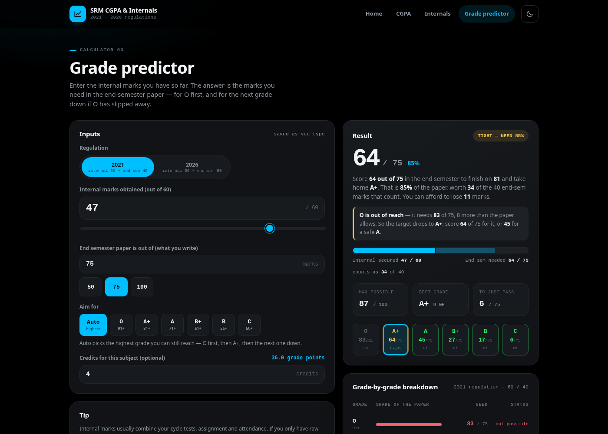
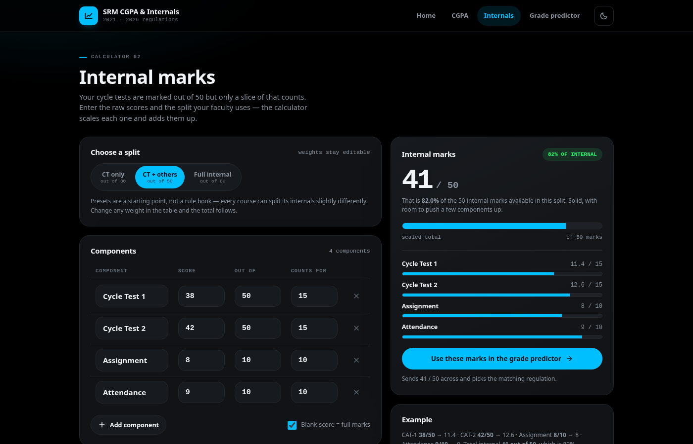
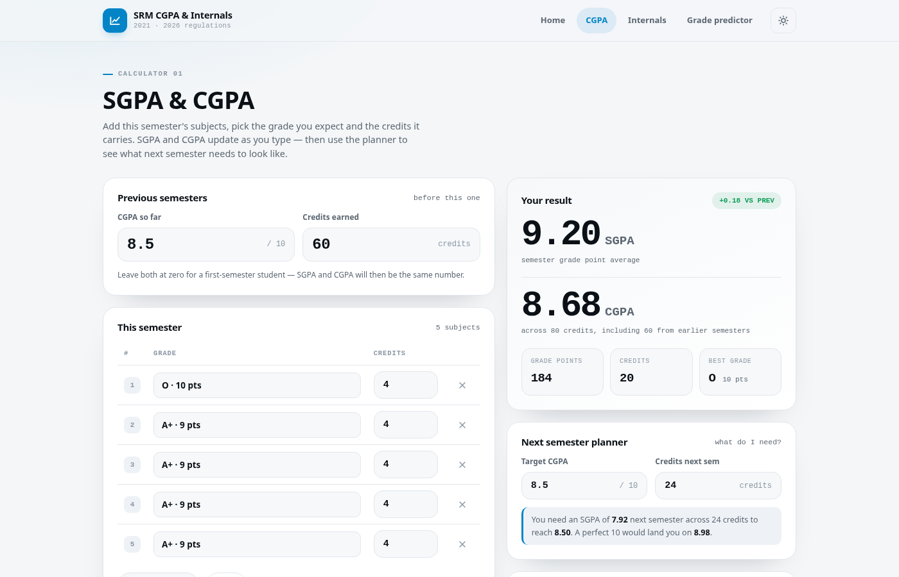

<div align="center">


# SRM CGPA &amp; Internals

**Three calculators for SRM students — and one of them tells you exactly how many marks you need in the end semester for an O.**

[](https://s4i1m.github.io/SRM_CGPA_Internals/)
[](#how-the-numbers-work)
[](#tech)
[](LICENSE)

</div>



## What's inside

| Tool | What it answers | Page |
| --- | --- | --- |
| **Grade predictor** | “I have 47/60 internals — how much do I need in the end sem for an A+?” | [`grade-predictor.html`](grade-predictor.html) |
| **Internal marks** | “My CAT-1 is 38/50. What is that worth?” | [`internals.html`](internals.html) |
| **SGPA & CGPA** | “What CGPA will this semester leave me on?” | [`cgpa.html`](cgpa.html) |

All three are static pages. No build step, no framework, no server, no account. Everything is
calculated in your browser and remembered in `localStorage` so the form is still filled in next time.

## Use cases

- **Two weeks before the end sem.** Enter your internals and the paper total; get the marks you need,
  rounded up to a whole mark, plus what happens if you drop a few.
- **The day cycle test results go up.** Convert raw CAT scores into the internals that count, then
  hand the total to the predictor in one click.
- **Results season.** Project your SGPA, see the new CGPA, and check what next semester has to look
  like to hit your target.
- **Placement cut-offs.** Most on-campus cut-offs are a single number. Work backwards from it.

## The grade predictor



- Aims at **O** automatically. If O has slipped out of reach it drops to the next grade that is still
  possible and tells you why, with the gap in marks.
- Shows the required score for **every grade at once** — O, A+, A, B+, B, C — in the result card, then a
  fuller breakdown with bars below.
- The end-semester paper total is yours to set (75 by default), because papers are written for 75 or
  100 and only later scaled to the 40/50 weight that counts.
- A “what if I score…” slider runs the calculation backwards: pick a paper score, see the grade.
- Rounds **up** to a whole mark so it never under-promises.

## SGPA &amp; CGPA



Live SGPA and CGPA as you add subjects, credits weighted properly, plus a planner that answers
“what SGPA do I need next semester to reach 8.5?” — including the honest case where the target is no
longer reachable and the best possible number instead.

## Dark and light

Every page has a theme toggle in the header. The choice is remembered per browser, and if you have
never toggled it the site follows your operating system preference. Both themes are designed rather
than inverted — the light theme is a warm grey canvas with white cards, not black-on-white.

## How the numbers work

| | 2021 regulation | 2026 regulation |
| --- | --- | --- |
| Internal weight | 60% | 50% |
| End-semester weight | 40% | 50% |
| Pass requirement | 50% of the total | 50% of the total **and** ≥45% in the end sem |

Grade bands are the same in both regulations:

| Grade | O | A+ | A | B+ | B | C | F |
| --- | --- | --- | --- | --- | --- | --- | --- |
| Marks | 91–100 | 81–90 | 71–80 | 61–70 | 56–60 | 50–55 | below 50 |
| Grade points | 10 | 9 | 8 | 7 | 6 | 5 | 0 |

**The one caveat:** SRM normalises internal marks before combining them with the end-semester marks,
and the exact method is set by the Controller of Examinations. The calculators apply the published
formula exactly, so treat the result as a well-founded estimate rather than a guarantee.

Sources: [SRM academic regulations 2021](https://webstor.srmist.edu.in/web_assets/downloads/2023/b-tech-mtech-ntegrated-2021-regulations.pdf) ·
[SRM academic regulations 2026](https://webstor.srmist.edu.in/web_assets/downloads/2026/srmist-fet-btech-mtech-integrated-regulations-2026.pdf).

## Run it locally

```bash
git clone https://github.com/S4i1M/SRM_CGPA_Internals.git
cd SRM_CGPA_Internals
open index.html        # macOS  (xdg-open on Linux, start on Windows)
```

That is the whole setup. A local server is optional, but if you want one:

```bash
python3 -m http.server 8000
```

## Deploy to GitHub Pages

1. Push the repository to GitHub.
2. **Settings → Pages → Source: Deploy from a branch → `main` / `root`.**
3. The site appears at `https://<username>.github.io/SRM_CGPA_Internals/`.

The `.nojekyll` file is already there so Pages serves the files as they are.

## Project structure

```
.
├── index.html              landing page — what the tools do
├── grade-predictor.html    marks needed in the end semester
├── internals.html          cycle tests → internal marks
├── cgpa.html               SGPA / CGPA calculator
├── assets/
│   ├── css/style.css       design system: tokens, layout, components, both themes
│   ├── js/app.js           theme toggle, storage, shared helpers
│   ├── js/predictor.js     grade predictor logic
│   ├── js/internals.js     internal marks logic
│   ├── js/cgpa.js          SGPA / CGPA logic
│   └── img/                favicon + README screenshots
├── LICENSE
└── .nojekyll
```

## Tech

Plain HTML, CSS and JavaScript. No framework, no bundler, no tracking, no cookies. The only network
request on a normal visit is the Google Fonts stylesheet; without it the site falls back to system
fonts and works exactly the same.

## Browser support

Chrome, Edge, Firefox and Safari (including iOS) on desktop and mobile. Tested down to a 360 px
viewport — no horizontal scrolling on any page. Respects `prefers-reduced-motion`, keeps focus
outlines for keyboard users, and has a print stylesheet if you would rather save a result as a PDF.

## Roadmap

- [ ] Attendance calculator with the 75% rule
- [ ] Save several semesters and chart the CGPA trend
- [ ] Shareable result links
- [ ] Subject-wise internal tracker across a semester

## Contributing

Issues and pull requests are welcome — especially if your course splits its internals differently
from the presets. Open an issue with the split and it can be added.

## License

[MIT](LICENSE) © [S4i1m](https://s4i1m.github.io/whoami/)
